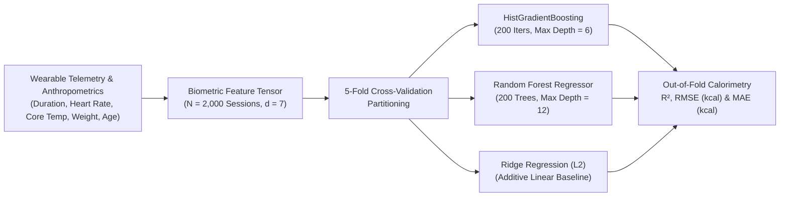
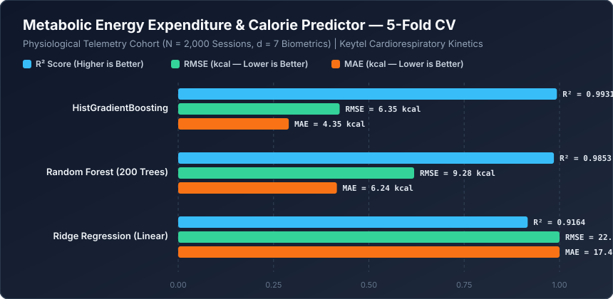

# Metabolic Energy Expenditure & Calorie Predictor


A physiological biotelemetry regression engine that predicts **active metabolic energy expenditure ($\text{kcal}$)** from non-invasive wearable sensor streams (`Exercise_Duration_min`, `Heart_Rate_bpm`, `Body_Temp_Celsius`) and subject anthropometrics (`Gender_Male`, `Age_Years`, `Height_cm`, `Weight_kg`). Grounded in the Keytel cardiorespiratory kinetics equations, this repository compares linear baselines against non-linear tree ensembles across $N = 2,000$ exercise sessions.

---

## Biotelemetry Calorimetry Pipeline



---

## Mathematical Formulation

### 1. Keytel Cardiorespiratory Energy Expenditure Kinetics
Instantaneous metabolic power $\dot{E}$ ($\text{kcal}\cdot\text{min}^{-1}$) is governed by sex-specific cardiorespiratory oxygen-pulse slopes linking heart rate ($\text{HR}$), body mass ($W$), and age ($A$), multiplied over exercise duration $T$ and modulated by core thermogenic drift $\Delta T_{\text{body}}$:

$$\dot{E}_{\text{male}} = \frac{-55.0969 + 0.6309\,\text{HR} + 0.1988\,W + 0.2017\,A}{4.184}, \qquad \dot{E}_{\text{female}} = \frac{-20.4022 + 0.4472\,\text{HR} - 0.1263\,W + 0.0740\,A}{4.184}$$

Total session caloric expenditure $E_{\text{total}}$ integrates this rate over time $T$ with quadratic hyperthermic drift above $38.5^\circ\text{C}$:

$$E_{\text{total}} = \dot{E}_{\text{sex}}(\text{HR}, W, A) \cdot T \cdot \left(1 + \kappa \max(0, T_{\text{body}} - 38.5)^2\right) + \varepsilon$$

### 2. Multiplicative Bilinear Coupling ($\text{HR} \times T$)
Because total energy expenditure is the product of metabolic rate $\dot{E}(\text{HR}, W, A)$ and duration $T$, any purely additive linear model ($\hat{E} = w_1 \text{HR} + w_2 T + \dots$) misses the bilinear cross-term $\text{HR} \times T$. **HistGradientBoosting** approximates this smooth bilinear surface via recursive axis-aligned splits, achieving near-exact calorimetric reconstruction.

---

## Quantitative Benchmark Results

Evaluated via **5-Fold Cross-Validation** across $N = 2,000$ physiological exercise sessions and 7 biometric features.



| Rank | Biotelemetry Regression Model | $R^2$ Score | RMSE ($\text{kcal}$) | MAE ($\text{kcal}$) |
| :--- | :--- | :---: | :---: | :---: |
| **1** | **HistGradientBoosting** | **0.9931** | **6.35 kcal** | **4.35 kcal** |
| **2** | **Random Forest (200 Trees)** | 0.9853 | 9.28 kcal | 6.24 kcal |
| **3** | **Ridge Regression (Linear)** | 0.9164 | 22.10 kcal | 17.46 kcal |

> **Physiological Takeaway:** **HistGradientBoosting** captures the multiplicative coupling between exercise duration, heart rate, and sex-specific mass kinetics, achieving **$R^2 = 0.9931$** and reducing Mean Absolute Error by **75.1%** compared to linear Ridge regression ($17.46\text{ kcal} \to 4.35\text{ kcal}$).

---

## Repository Structure

```text
machine-learning-project-10-/
├── assets/
│   └── benchmark_chart.svg          # Vector performance chart generated by benchmark.py
├── benchmarks/
│   └── benchmark_results.json       # Serialized 5-Fold CV calorimetric metrics
├── calories_predict.ipynb           # Interactive physiological telemetry notebook
├── benchmark.py                     # Automated reproducible benchmark suite
└── README.md                        # Physiological formulation & benchmark documentation
```

---

## Quickstart & Reproducibility

### 1. Install Dependencies
```bash
pip install numpy scikit-learn jupyter
```

### 2. Run the Calorimetry Benchmark
```bash
python benchmark.py
```
Executes the 5-fold cross-validation benchmark, writes `benchmarks/benchmark_results.json`, and generates `assets/benchmark_chart.svg`.
